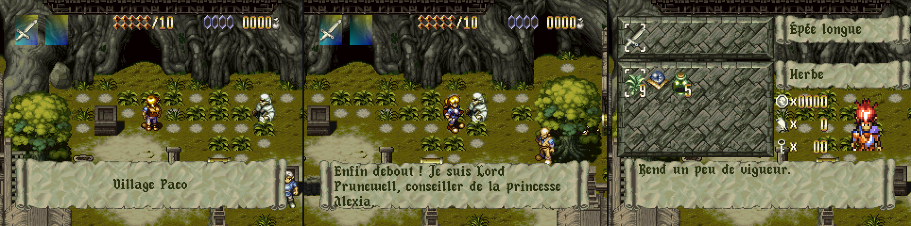
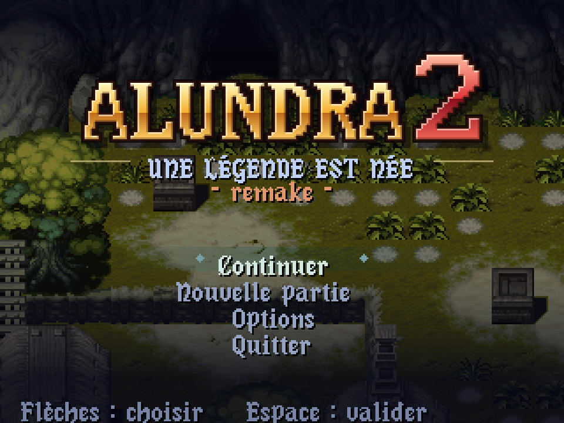
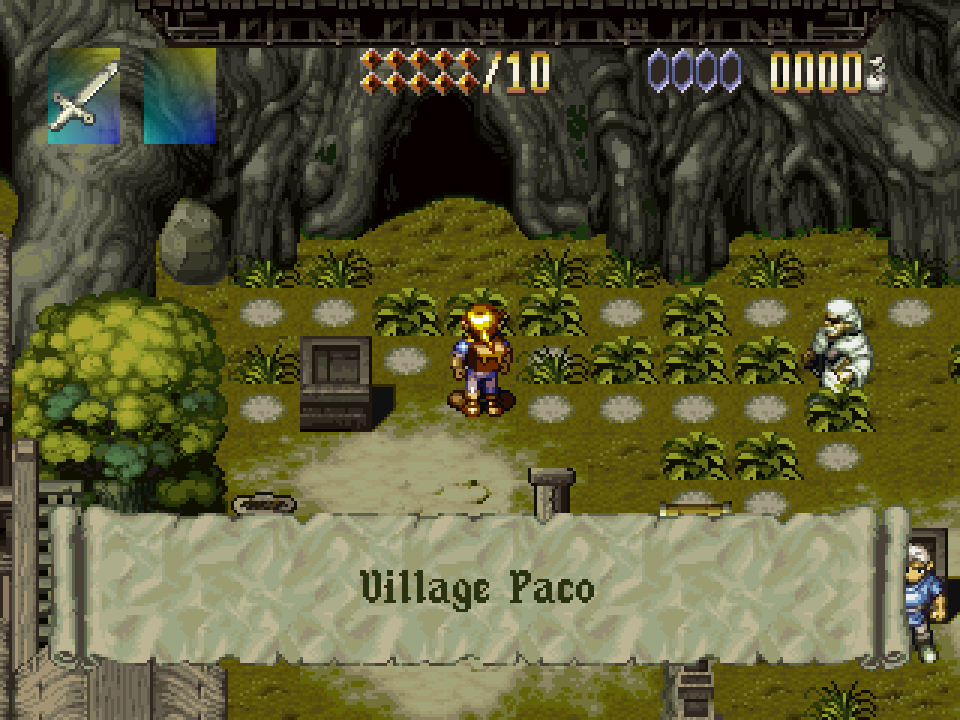
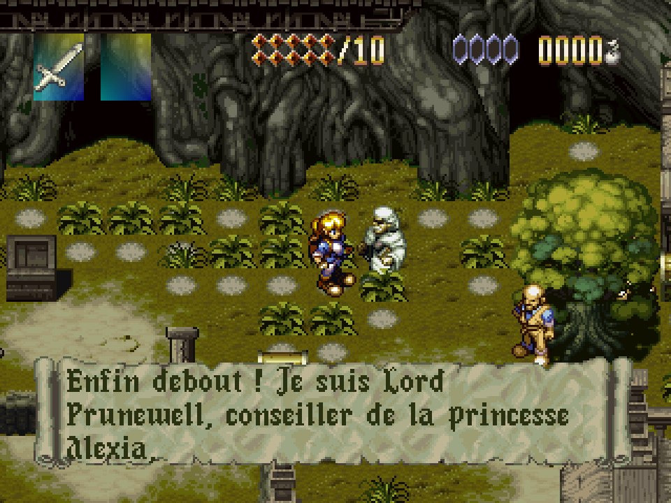
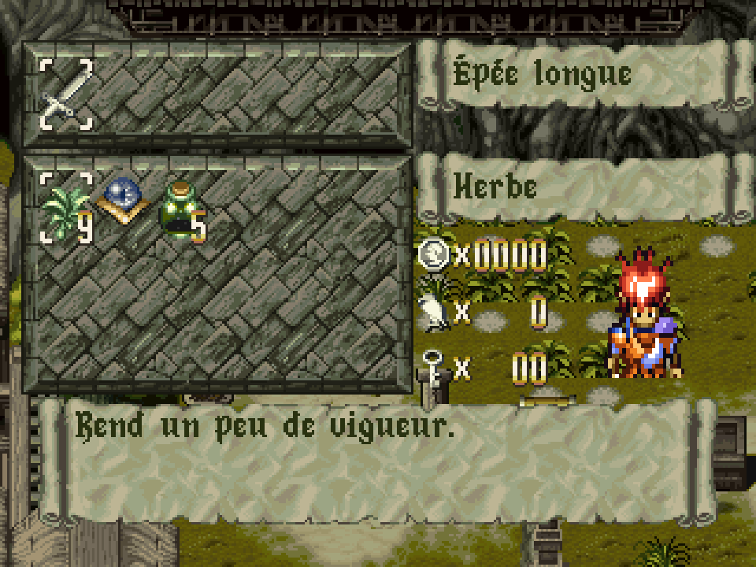
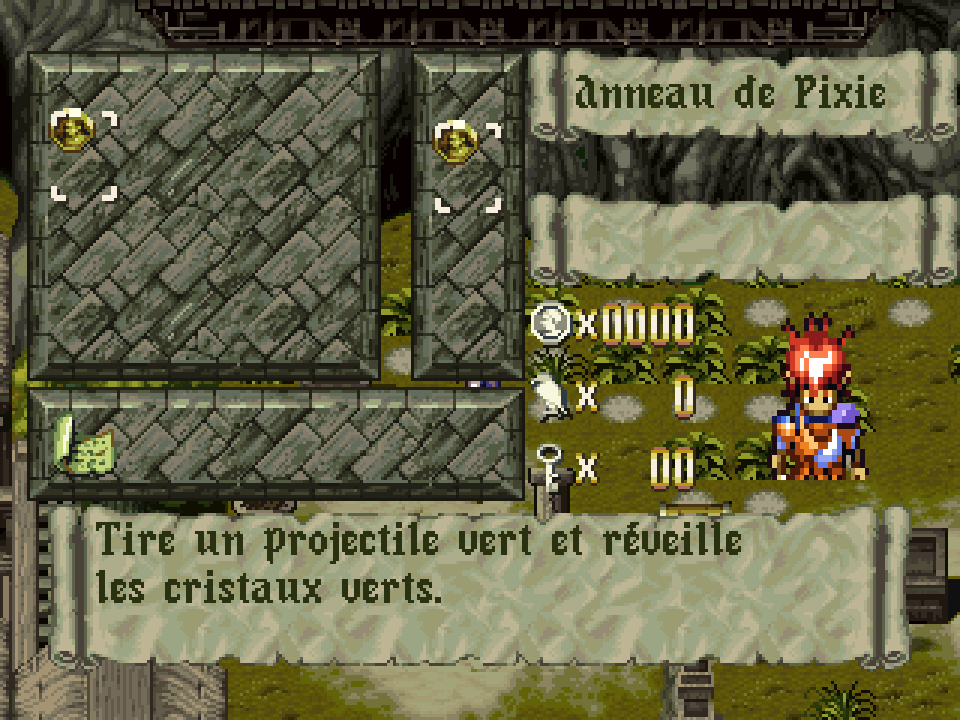
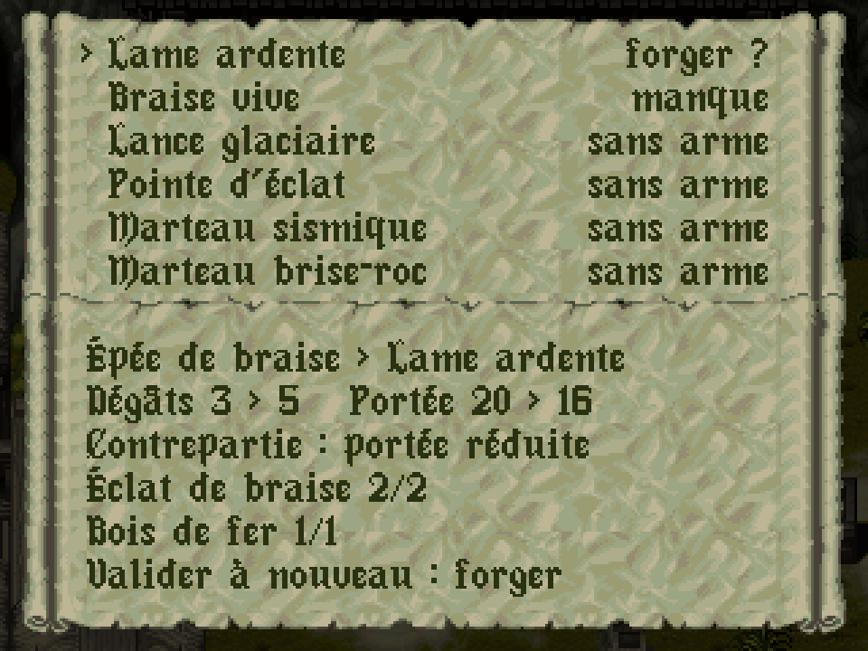

<div align="center">



# Alundra2Recomp

**Alundra 2 rebuilt in C++20 — playable on PC and on a native PlayStation 1.**

A hand-written 2D reimplementation with the visual language of classic 16-bit Alundra and the
story of Alundra 2. One codebase, two targets: a complete SDL3 build for PC and a real MIPS
PS-X EXE that uses the console GPU, controller and memory card through PSn00bSDK.

[](LICENSE)
[](#features)
[](#build-and-test)
[](#playstation-1-target)
[](#build-and-test)

[Screenshots](#screenshots) · [Features](#features) · [Build](#build-and-test) ·
[PlayStation 1](#playstation-1-target) · [Contributing](#contributing) · [License](#license)

</div>

> **This is a remake, not a static recompilation.** No emulator is involved on PC, and the console
> build is not a Windows executable converted to a disc image. It is original C++20 code with
> original tooling, published with source and documentation only.

## Screenshots

All images below are native 320×240 frames captured from the rebuilt executable with a
deterministic `--auto` script, scaled 3× with nearest-neighbour filtering.

| Title | Exploration | Dialogue |
|:---:|:---:|:---:|
|  |  |  |
| *Title screen* | *First village (zone 011)* | *Bitmap dialogue and portraits* |

| Items | Equipment | Forge |
|:---:|:---:|:---:|
|  |  |  |
| *Inventory and consumables* | *Rings and pockets* | *Weapon upgrades* |

## Features

- **PC / SDL3** — the reference build: exploration, dialogue, inventory, equipment, forge,
  saves, the A → Z route and a deterministic CTest suite.
- **Native PlayStation 1** — a playable prototype of zone 011 built as a MIPS PS-X EXE with
  PSn00bSDK, packaged as a bootable NTSC disc image.
- **No external engine** — the renderer, input, audio, data formats and tools are part of this
  repository.
- **Deterministic automation** — `--auto`, `--expect`, `--savetest` and `--shot` drive the same
  code paths used by the regression tests and the screenshots above.
- **Single codebase, two backends** — the PC and console targets share the game logic.

| Target | Status |
|---|---|
| PC (SDL3) | Playable: dialogue, menus, equipment, forge, saves, A → Z progression, 81 CTest cases |
| PlayStation 1 | Prototype: zone 011 scenery, hero, camera, run, jump, attack, four-heart HUD |
| PS1 disc image | Built locally for burning; never distributed in this repository |

## Important notice

This repository contains **no commercial game resources**: no sprites, maps, fonts, music,
video or disc images from the Alundra games. Building either target requires you to supply your
own legally obtained resources and tools in the ignored directories `assets/`, `extracted/`,
`gp/`, `images/` and `external/`.

`src/a1_font.h` is included so that the PC build and the tests work immediately after cloning.
PlayStation 1 data blobs are regenerated locally by the scripts in `tools/`.

Alundra is a trademark of its respective owner. This is an independent, non-commercial fan
project; no game data is redistributed here.

## Requirements

### PC

- Windows with PowerShell
- CMake 4.4 or newer, Ninja, Python 3.12
- MinGW toolchain in `external/`
- SDL3 3.4.20 in `external/`

### PlayStation 1

- PSn00bSDK 0.24, a MIPS compiler and `mkpsxiso` in `external/tools/`
- OpenBIOS (open-source) for emulator testing
- A compatible emulator for validation (PCSX-Redux or DuckStation)
- A real console, controller and memory card for hardware validation

Toolchains and BIOS files are not versioned.

## Build and test

From the repository root:

```powershell
powershell -ExecutionPolicy Bypass -File build.ps1
py -3.12 tools\validate_data.py
ctest --test-dir build --output-on-failure
git diff --check
```

Expected result: a successful build, `ERR: 0 | WARN: 0` from the validator, a fully green CTest
suite and no whitespace errors.

## PlayStation 1 target

```powershell
powershell -ExecutionPolicy Bypass -File tools\build_ps1.ps1
powershell -ExecutionPolicy Bypass -File tools\ps1_smoke.ps1 -Seconds 300
```

The PS1 build produces a PS-X EXE, a BIN/CUE pair and a 2048-byte-sector ISO in `ps1/build/`.
The image prepared for burning is converted into `ps1/a_graver/`. None of these files are
tracked. Technical notes live in `docs/ps1/`.

| Action | Controller |
|---|---|
| Move | D-pad |
| Run | R1 |
| Jump | Cross |
| Attack | Square |
| Quick save | Start |
| Save and return to title | Select |

## Automation flags

```text
--auto <script>        Deterministic input script
--expect <key=value>   Assertion on the final game state
--savetest             Save/load regression scenario
--zone <id>            Start directly in a zone
--at <x> <y>           Starting position
--shot <file.bmp>      Write the last rendered frame (used for the screenshots above)
```

## Repository layout

```text
src/              C++20 core, SDL3 PC backend and PS1 backend
data/             Dialogues, items, maps and gameplay data
tools/            Converters, validators and build scripts
tests/            Deterministic scenarios and fixtures
ps1/              PS1 CMake configuration and build outputs
docs/ps1/         PlayStation 1 technical notes
docs/remake/      Content and narrative coverage notes
docs/screenshots/ README screenshots and hero image
```

## Contributing

Contributions are welcome. Please read [CONTRIBUTING.md](CONTRIBUTING.md) before opening a pull
request. The PC build stays the reference for non-regression, and every gameplay change should
keep or add a deterministic `--auto` scenario.

## License

Source code and documentation are published under **GPL-3.0**. See [LICENSE](LICENSE) and
[SOURCES_LICENSES.md](SOURCES_LICENSES.md). Commercial Alundra assets are not included and
remain the property of their respective owners.
